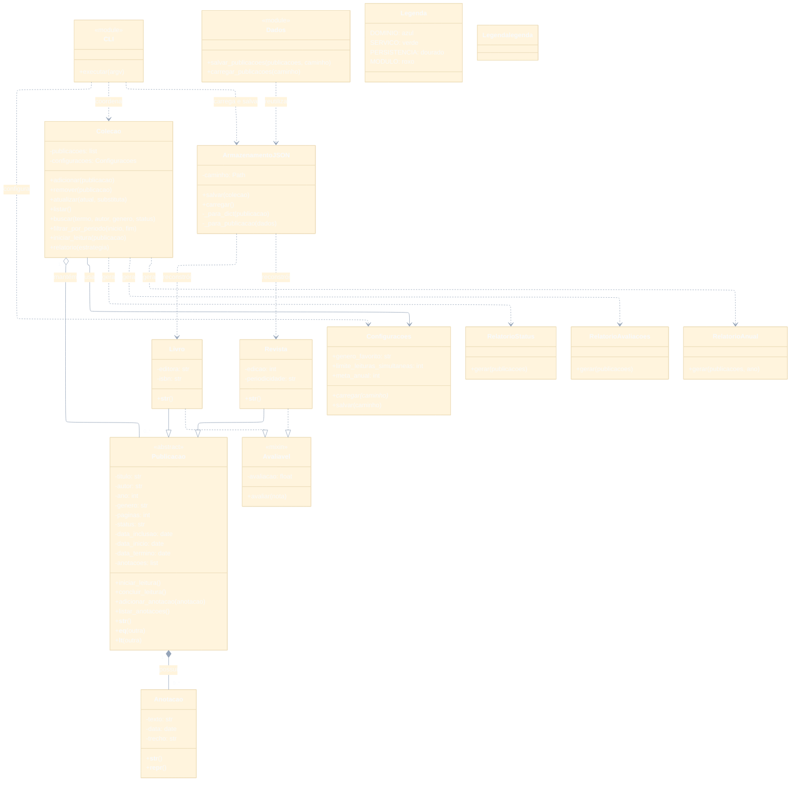

# Biblioteca pessoal digital

Aplicação de linha de comando (CLI), escrita em Python, para manter um acervo pessoal de livros e revistas. Permite registrar o andamento das leituras, avaliações e anotações, pesquisar publicações e gerar relatórios. Os dados do acervo são armazenados em um arquivo JSON.

## Navegação rápida

- [Requisitos](#requisitos)
- [Estrutura do projeto](#estrutura-do-projeto)
- [Baixar e executar](#baixar-e-executar-o-projeto)
- [Comandos da CLI](#comandos-da-cli)
- [Arquivos de dados e configurações](#arquivos-de-dados-e-configura%C3%A7%C3%B5es)
- [Classes e responsabilidades](#classes-e-responsabilidades)
- [Diagrama UML](#diagrama-uml)
- [Testes](#testes)

## Requisitos

- Python 3.10 ou superior.
- Git, para clonar o repositório.
- Não é necessário instalar bibliotecas externas.

## Estrutura do projeto

```text
.
├── scr/
│   ├── __init__.py
│   ├── banco_de_dados/
│   │   └── biblioteca.json
│   └── biblioteca/
│       ├── __init__.py
│       ├── cli.py              # Comandos da linha de comando
│       ├── dominio/            # Entidades e regras do domínio
│       │   ├── __init__.py
│       │   ├── anotacao.py
│       │   ├── avaliavel.py
│       │   ├── livro.py
│       │   ├── publicacao.py
│       │   └── revista.py
│       ├── persistencia/       # Leitura e gravação do JSON
│       │   ├── __init__.py
│       │   ├── armazenamento_json.py
│       │   └── dados.py
│       └── servicos/           # Coleção, configurações e relatórios
│           ├── __init__.py
│           ├── colecao.py
│           └── configuracoes.py
├── tests/                      # Testes automatizados
│   ├── conftest.py
│   └── test_biblioteca.py
├── main.py                     # Ponto de entrada
├── requirements-dev.txt        # Dependências para desenvolvimento e testes
├── .gitignore                  # Arquivos gerados localmente ignorados pelo Git
└── README.md
```

## Baixar e executar o projeto

```bash
git clone https://github.com/Dontspar/POO-TEMA-3-BIBLIOTECA-PESSOAL-DIGITAL.git
cd POO-TEMA-3-BIBLIOTECA-PESSOAL-DIGITAL
python main.py --help
```

No Windows, também pode ser necessário usar o comando `py` (por exemplo, `py main.py --help`).

Para ver as opções de um comando específico, acrescente `--help` depois dele, por exemplo:

```bash
python main.py cadastrar --help
python main.py listar --help
```

## Comandos da CLI

Execute os exemplos na pasta do projeto. Textos entre `< >` representam valores que você deve substituir; mantenha aspas em títulos, autores e frases que contenham espaços.

| Comando | Para que serve | Exemplo |
| --- | --- | --- |
| `cadastrar livro` | Adiciona um livro. Título, autor, ano, gênero e páginas são obrigatórios; editora e ISBN são opcionais. | `python main.py cadastrar livro --titulo "Duna" --autor "Frank Herbert" --ano 1965 --genero "Ficção científica" --paginas 500 --editora "Aleph" --isbn 9788525057919` |
| `cadastrar revista` | Adiciona uma revista. Usa os mesmos dados básicos do livro; edição e periodicidade são opcionais (por padrão, edição 1 e periodicidade Mensal). | `python main.py cadastrar revista --titulo "Ciência Hoje" --autor "Vários autores" --ano 2025 --genero "Ciência" --paginas 80 --edicao 400 --periodicidade Mensal` |
| `listar` | Mostra o acervo. É possível combinar busca por texto, autor, gênero e status. | `python main.py listar --busca duna --autor "Frank Herbert" --status LIDO` |
| `atualizar` | Altera título, autor, gênero ou número de páginas. Primeiro informe o título e autor atuais para localizar a publicação. | `python main.py atualizar "Duna" "Frank Herbert" --genero "Ficção" --paginas 520` |
| `remover` | Remove uma publicação identificada pelo título e autor. | `python main.py remover "Duna" "Frank Herbert"` |
| `status` | Inicia ou conclui uma leitura. Uma avaliação opcional só pode ser registrada ao concluir, e deve estar entre 0 e 10. | `python main.py status "Duna" "Frank Herbert" concluir --avaliacao 9` |
| `anotar` | Registra uma anotação para uma publicação. O trecho citado é opcional. | `python main.py anotar "Duna" "Frank Herbert" "Gostei do universo" --trecho "Medo é a mente assassina"` |
| `anotacoes` | Lista as anotações de uma publicação, com suas datas. | `python main.py anotacoes "Duna" "Frank Herbert"` |
| `relatorio` | Gera um relatório de status, avaliações ou leituras concluídas no ano. O tipo padrão é `status`. | `python main.py relatorio anual --ano 2026` |
| `configurar` | Define gênero favorito, limite de leituras simultâneas e meta anual. | `python main.py configurar --genero-favorito "Ficção científica" --limite-leituras-simultaneas 2 --meta-anual 20` |

### Opções de busca e período

O comando `listar` aceita `--busca` (procura no título, autor e gênero), `--autor`, `--genero` e `--status`. Também pode filtrar pelas datas de início da leitura usando `--inicio` e `--fim`, no formato `AAAA-MM-DD`; informe as duas datas juntas:

```bash
python main.py listar --inicio 2026-01-01 --fim 2026-12-31
```

Os status aceitos são `NÃO LIDO`, `LENDO` e `LIDO`. Para começar uma leitura:

```bash
python main.py status "Duna" "Frank Herbert" iniciar
```

Depois de iniciada, ela pode ser concluída e avaliada:

```bash
python main.py status "Duna" "Frank Herbert" concluir --avaliacao 9
```

Para atualizar vários campos, inclua todas as opções desejadas na mesma chamada. Os relatórios são impressos em JSON. O relatório `avaliacoes` mostra a média das publicações avaliadas e as cinco maiores notas; o relatório `anual` recebe `--ano` opcional e informa quantas leituras foram concluídas naquele ano. Se houver uma meta anual configurada, o resultado também indica se ela foi atingida.

### Arquivos de dados e configurações

Por padrão, o acervo fica em `scr/banco_de_dados/biblioteca.json`; as configurações ficam em `settings.json` na raiz do projeto. A pasta e o arquivo do acervo são criados quando necessário. É possível escolher caminhos diferentes passando `--arquivo` ou `--config` antes do subcomando:

```bash
python main.py --arquivo dados/meu_acervo.json --config dados/minhas_configuracoes.json listar
```

O comando `configurar` grava os valores informados e deixa como `null` as opções omitidas. Portanto, informe novamente todos os valores que deseja manter:

```bash
python main.py configurar --genero-favorito "Ficção" --limite-leituras-simultaneas 2 --meta-anual 20
```

## Classes e responsabilidades

As tabelas abaixo resumem as classes do projeto, seus atributos centrais e os métodos mais importantes. Propriedades indicadas como “somente leitura” não possuem setter público.

### Domínio da biblioteca

| Classe | Foco | Atributos principais | Métodos principais |
| --- | --- | --- | --- |
| `Publicacao` | Classe abstrata com os dados e regras compartilhados por livros e revistas. | `titulo`, `autor`, `ano`, `genero`, `paginas`, `status`, `data_inclusao`, `data_inicio`, `data_termino`, `anotacoes`. | `iniciar_leitura()`, `concluir_leitura()`, `adicionar_anotacao()`, `listar_anotacoes()`, `__str__()`, `__repr__()`, `__eq__()`, `__lt__()`, `__hash__()`; valida os campos por propriedades. |
| `Livro` | Representa um livro; herda os dados de `Publicacao` e as regras de `Avaliavel`. | Atributos herdados, mais `editora` e `isbn`. | `__init__()`, `__str__()`; propriedades de leitura e escrita para `editora` e `isbn`. |
| `Revista` | Representa uma revista; herda os dados de `Publicacao` e as regras de `Avaliavel`. | Atributos herdados, mais `edicao` e `periodicidade`. | `__init__()`, `__str__()`; propriedades de leitura e escrita para `edicao` e `periodicidade`. |
| `Avaliavel` | Mixin que permite atribuir uma nota depois que a leitura for concluída. | `avaliacao`. | `avaliar(nota)`, que valida o status e a faixa de 0 a 10. |
| `Anotacao` | Guarda uma observação associada a uma publicação. | `texto`, `data`, `trecho` (opcional). | `__str__()`, `__repr__()`; propriedades de leitura e escrita para os atributos. |
| `Colecao` | Mantém as publicações, impede duplicatas e oferece busca, filtros e relatórios. | Lista interna de publicações e `configuracoes`. | `adicionar()`, `remover()`, `atualizar()`, `listar()`, `buscar()`, `filtrar_por_status()`, `filtrar_por_genero()`, `filtrar_por_periodo()`, `iniciar_leitura()`, `relatorio()`. |

### Relatórios e suporte

| Classe | Foco | Atributos principais | Métodos principais |
| --- | --- | --- | --- |
| `RelatorioStatus` | Conta publicações por status e calcula percentuais. | Não mantém atributos próprios. | `gerar(publicacoes)`. |
| `RelatorioAvaliacoes` | Calcula a média das notas e encontra as cinco maiores avaliações. | Não mantém atributos próprios. | `gerar(publicacoes)`. |
| `RelatorioAnual` | Conta leituras concluídas em um ano escolhido. | Não mantém atributos próprios. | `gerar(publicacoes, ano=None)`. |
| `Configuracoes` | Carrega e salva preferências e limites opcionais em JSON. | `genero_favorito`, `limite_leituras_simultaneas`, `meta_anual`. | `carregar(caminho)`, `salvar(caminho)`. |
| `ArmazenamentoJSON` | Converte publicações para JSON e reconstrói os objetos ao carregar o acervo. | `caminho` do arquivo. | `salvar(colecao)`, `carregar()`; conversões internas `_para_dict()` e `_para_publicacao()`. |

Além dessas classes, `scr/biblioteca/persistencia/dados.py` oferece as funções `salvar_publicacoes()` e `carregar_publicacoes()` como uma interface simples para persistência.

## Organização e decisões de design

- `Publicacao` é abstrata; `Livro` e `Revista` herdam dela e do mixin `Avaliavel` (herança múltipla).
- As propriedades de `Publicacao` validam título, autor, ano, gênero, páginas e status.
- `Colecao` centraliza operações do acervo e usa estratégias intercambiáveis para relatórios (`RelatorioStatus`, `RelatorioAvaliacoes` e `RelatorioAnual`).
- `ArmazenamentoJSON` mantém a persistência separada das regras de domínio.
- Uma publicação é identificada pela combinação de título e autor; a comparação ignora diferenças entre maiúsculas e minúsculas.

### Diagrama UML

O diagrama mostra as entidades do domínio, os serviços de relatório e configuração, a persistência JSON e como a CLI conecta essas partes. `CLI` e `Dados` representam módulos com funções, não classes Python.



## Testes

Para executar a suíte de testes, instale as dependências de desenvolvimento e rode:

```bash
python -m pip install -r requirements-dev.txt
python -m pytest
```

A suíte cobre validações, transições de leitura, avaliações, anotações, duplicidade, filtros, relatórios, limites simultâneos, configurações e persistência.

``` 
Foram executados 26 testes: todos passaram.
```
Os itens “expiração”, “devolução” e “cálculo de taxa/compatibilidade” do enunciado não pertencem ao domínio descrito: esta biblioteca não controla empréstimos nem cobranças.

### Autoria
Desenvolvido por Tadeu Coêlho de Vasconcelos